# Design distinctness report

Generated by `npm run catalogue:distinct`. 52 live designs, 1326 pairs. Threshold 0.25 (share of structure that differs; colour and font excluded).

| # | Pair | Distance | What differs | Status |
|---|---|---|---|---|
| 1 | Column – Press | 0.19 | header, heading case | below threshold, accepted by owner |
| 2 | Clarity – Brief | 0.22 | heading style, decoration | below threshold, accepted by owner |
| 3 | Ledger – Column | 0.22 | heading style, decoration | below threshold, accepted by owner |
| 4 | Heritage – Regent | 0.27 | header, decoration | ok |
| 5 | Linea – Lens | 0.27 | entry layout, photo, skills look, heading case | ok |
| 6 | Brief – Aura | 0.30 | header, photo, skills look | ok |
| 7 | Harbor – Cameo | 0.30 | heading style, photo, side fill, skills look | ok |
| 8 | Regent – Scholar | 0.30 | heading style, entry layout, skills look, heading case | ok |
| 9 | Terra – Copper | 0.30 | heading style, decoration, photo | ok |
| 10 | Violet – Tangerine | 0.30 | heading style, decoration, photo | ok |
| 11 | Brief – Press | 0.32 | layout, section placement, side fill, heading case | ok |
| 12 | Clarity – Margin | 0.32 | heading style, entry layout, decoration | ok |
| 13 | Margin – Brief | 0.32 | heading style, entry layout, decoration | ok |
| 14 | Regent – Counsel | 0.32 | heading style, entry layout, decoration | ok |
| 15 | Brief – Grid | 0.35 | layout, section placement, section boxes / key numbers, skills look | ok |

## Side by side

**Column – Press** (0.19)

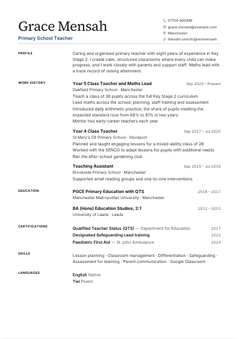 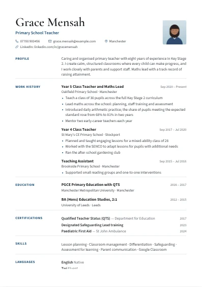

**Clarity – Brief** (0.22)

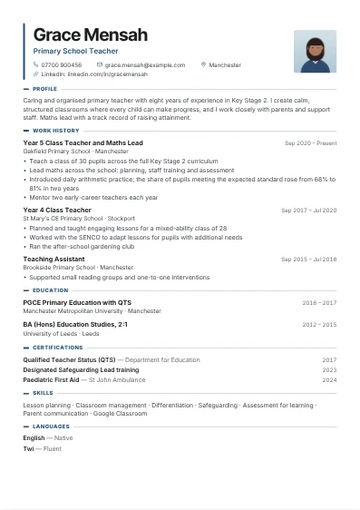 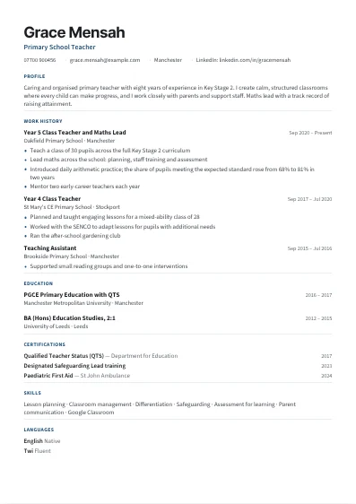

**Ledger – Column** (0.22)

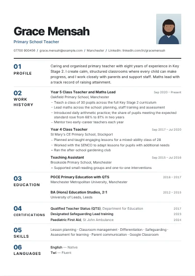 

**Heritage – Regent** (0.27)

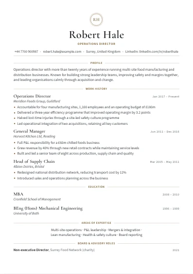 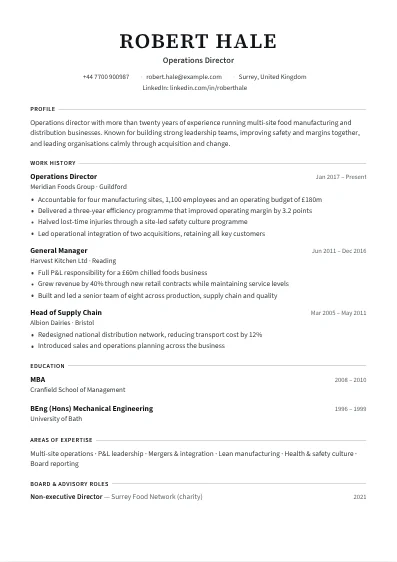

**Linea – Lens** (0.27)

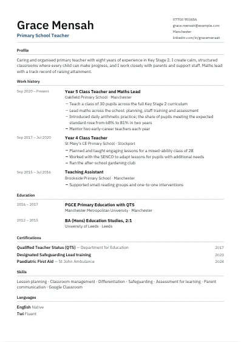 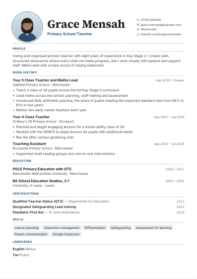

**Brief – Aura** (0.30)

 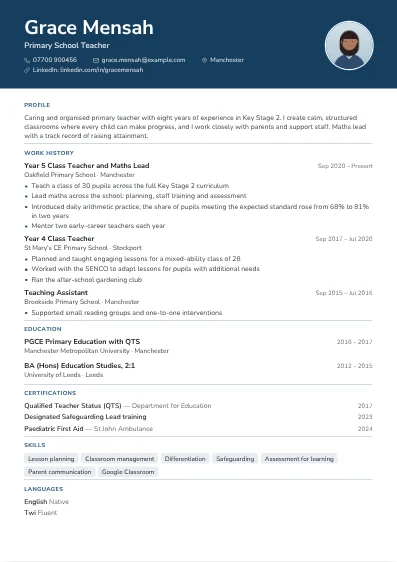

**Harbor – Cameo** (0.30)

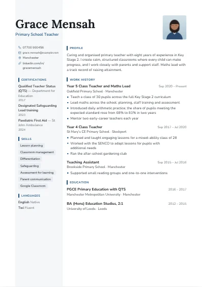 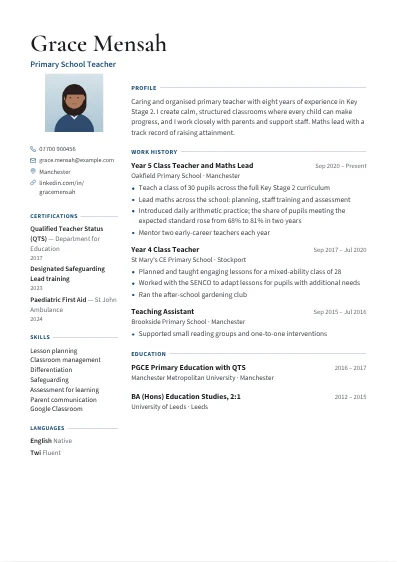

**Regent – Scholar** (0.30)

 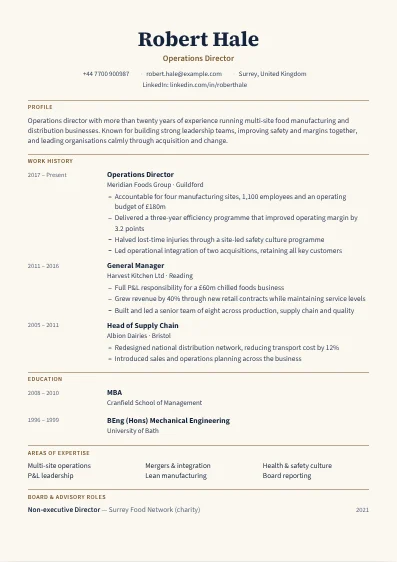

