# Design distinctness report

Generated by `npm run catalogue:distinct`. 51 live designs, 1275 pairs. Threshold 0.25 (share of structure that differs; colour and font excluded).

| # | Pair | Distance | What differs | Status |
|---|---|---|---|---|
| 1 | Electric – Aurora | 0.09 | decoration, photo | below threshold, **awaiting owner** |
| 2 | Terra – Copper | 0.09 | decoration, photo | below threshold, **awaiting owner** |
| 3 | Ultraviolet – Chromatic | 0.09 | decoration, photo | below threshold, **awaiting owner** |
| 4 | Violet – Tangerine | 0.09 | decoration, photo | below threshold, **awaiting owner** |
| 5 | Cyber – Blueprint | 0.15 | decoration, photo, skills look | below threshold, **awaiting owner** |
| 6 | Electric – Solar | 0.15 | decoration, photo, skills look | below threshold, **awaiting owner** |
| 7 | Graphite – Copper | 0.15 | decoration, photo, skills look | below threshold, **awaiting owner** |
| 8 | Neon – Emerald | 0.15 | decoration, photo, skills look | below threshold, **awaiting owner** |
| 9 | Solar – Aurora | 0.15 | decoration, photo, skills look | below threshold, **awaiting owner** |
| 10 | Terra – Graphite | 0.15 | decoration, photo, skills look | below threshold, **awaiting owner** |
| 11 | Clarity – Brief | 0.17 | heading style, decoration | below threshold, kept by owner |
| 12 | Citrus – Ruby | 0.18 | decoration, photo, section boxes / key numbers, heading case | below threshold, **awaiting owner** |
| 13 | Citrus – Cobalt | 0.18 | decoration, photo, skills look, heading case | below threshold, **awaiting owner** |
| 14 | Cyber – Cobalt | 0.18 | decoration, photo, section boxes / key numbers, heading case | below threshold, **awaiting owner** |
| 15 | Graphite – Tangerine | 0.18 | decoration, photo, skills look, heading case | below threshold, **awaiting owner** |
| 16 | Tangerine – Copper | 0.18 | decoration, photo, skills look, heading case | below threshold, **awaiting owner** |
| 17 | Terra – Tangerine | 0.18 | decoration, photo, skills look, heading case | below threshold, **awaiting owner** |
| 18 | Violet – Terra | 0.18 | decoration, photo, skills look, heading case | below threshold, **awaiting owner** |
| 19 | Violet – Graphite | 0.18 | decoration, photo, skills look, heading case | below threshold, **awaiting owner** |
| 20 | Violet – Copper | 0.18 | decoration, photo, skills look, heading case | below threshold, **awaiting owner** |
| 21 | Citrus – Cyber | 0.21 | decoration, photo, section boxes / key numbers, skills look | below threshold, **awaiting owner** |
| 22 | Citrus – Blueprint | 0.21 | decoration, photo, section boxes / key numbers, skills look | below threshold, **awaiting owner** |
| 23 | Ruby – Cobalt | 0.21 | decoration, photo, section boxes / key numbers, skills look | below threshold, **awaiting owner** |
| 24 | Heritage – Regent | 0.23 | header, decoration | below threshold, kept by owner |
| 25 | Blueprint – Cobalt | 0.24 | decoration, photo, section boxes / key numbers, skills look, heading case | below threshold, **awaiting owner** |
| 26 | Coral – Emerald | 0.24 | decoration, photo, section boxes / key numbers, skills look, heading case | below threshold, **awaiting owner** |
| 27 | Cyber – Ruby | 0.24 | decoration, photo, section boxes / key numbers, skills look, heading case | below threshold, **awaiting owner** |
| 28 | Neon – Coral | 0.24 | decoration, photo, section boxes / key numbers, skills look, heading case | below threshold, **awaiting owner** |
| 29 | Ocean – Magenta | 0.24 | decoration, photo, section boxes / key numbers, skills look, heading case | below threshold, **awaiting owner** |
| 30 | Ruby – Blueprint | 0.24 | decoration, photo, section boxes / key numbers, skills look, heading case | below threshold, **awaiting owner** |
| 31 | Linea – Lens | 0.26 | entry layout, photo, skills look, heading case | ok |
| 32 | Brief – Aura | 0.29 | header, photo, skills look | ok |
| 33 | Clarity – Margin | 0.29 | heading style, entry layout, decoration | ok |
| 34 | Harbor – Cameo | 0.29 | heading style, photo, side fill, skills look | ok |
| 35 | Margin – Brief | 0.29 | heading style, entry layout, decoration | ok |
| 36 | Regent – Counsel | 0.29 | heading style, entry layout, decoration | ok |
| 37 | Clarity – Heritage | 0.30 | header, decoration, photo, heading case | ok |
| 38 | Clarity – Regent | 0.30 | header, decoration, photo, heading case | ok |
| 39 | Atelier – Harbor | 0.33 | header, decoration, photo, side fill | ok |
| 40 | Regent – Scholar | 0.33 | heading style, entry layout, skills look, heading case | ok |

## Side by side

**Electric – Aurora** (0.09)

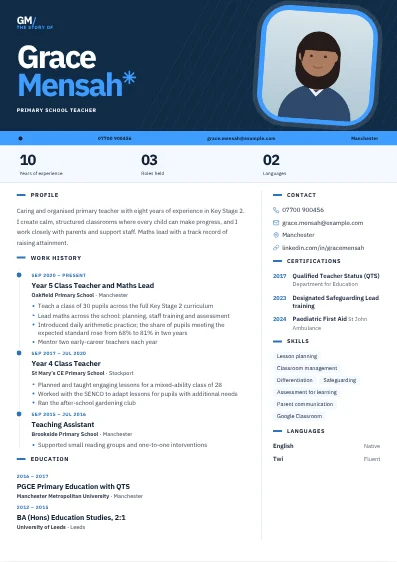 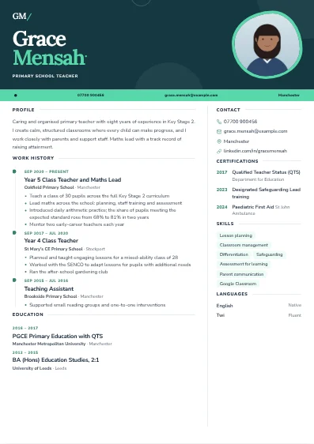

**Terra – Copper** (0.09)

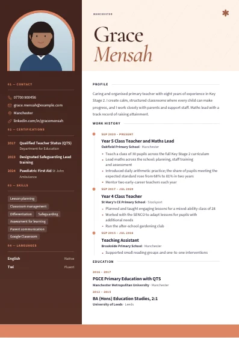 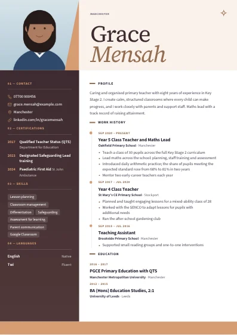

**Ultraviolet – Chromatic** (0.09)

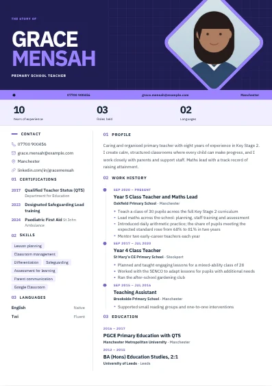 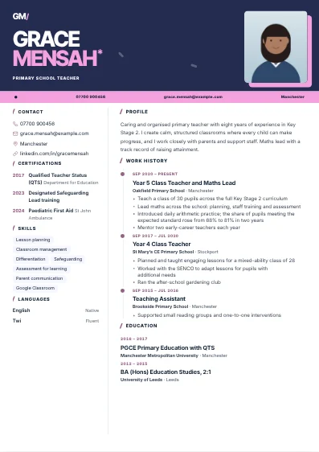

**Violet – Tangerine** (0.09)

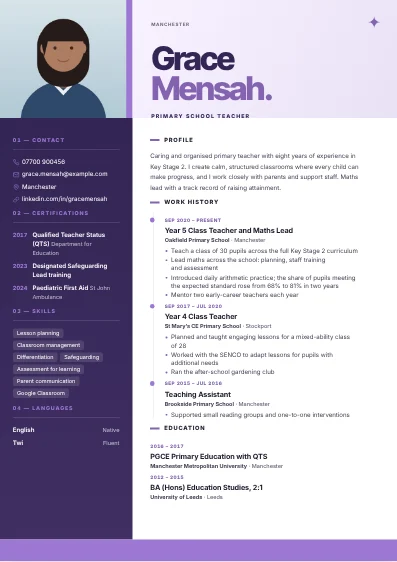 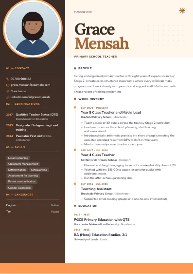

**Cyber – Blueprint** (0.15)

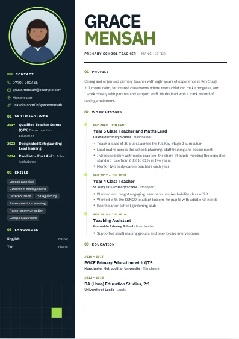 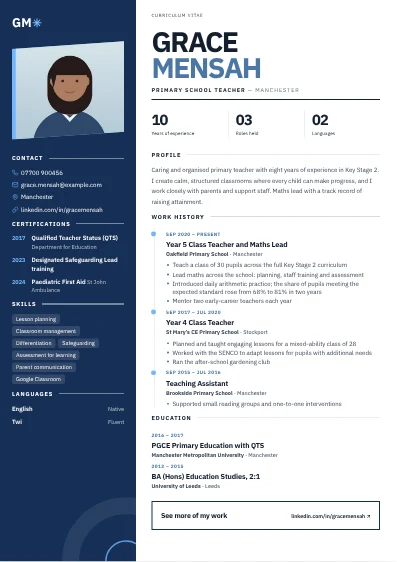

**Electric – Solar** (0.15)

 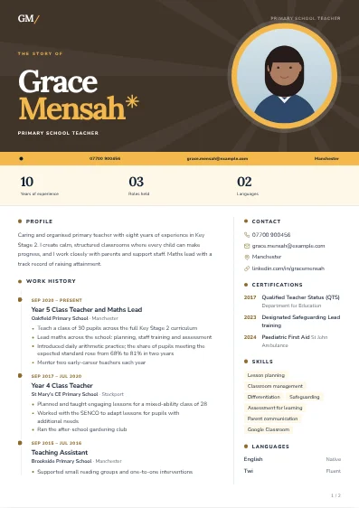

**Graphite – Copper** (0.15)

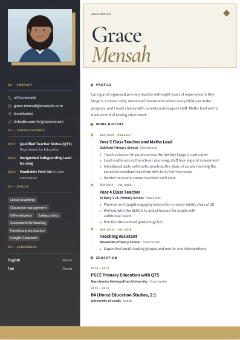 

**Neon – Emerald** (0.15)

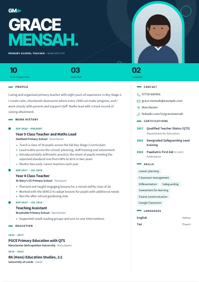 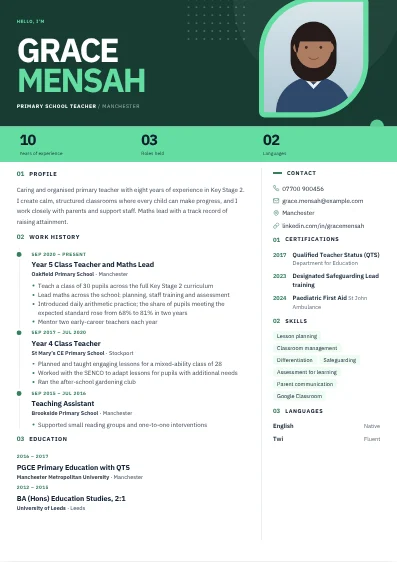

