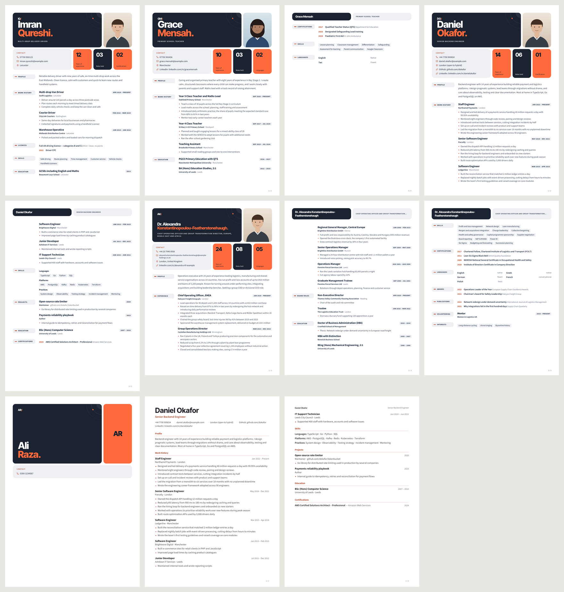
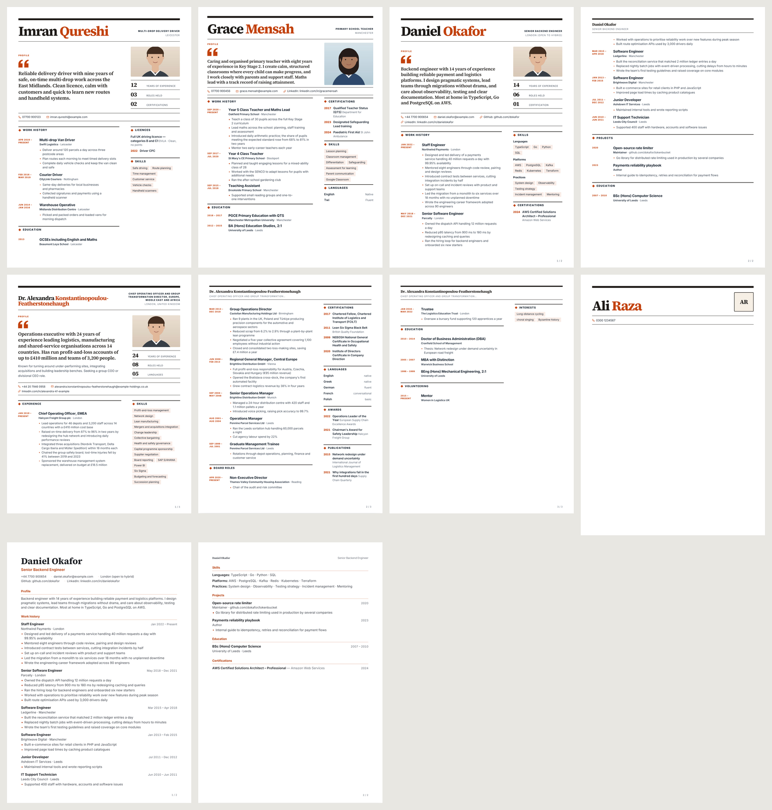
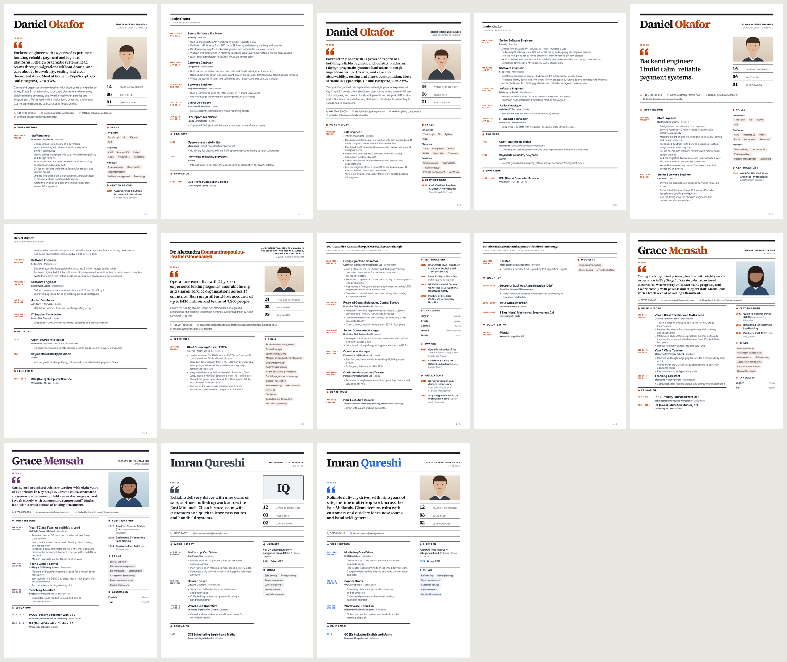

# Premium CV Template Scout: report for 2026-11-16

**Outcome:** 2 proposals. **Tessera** was REJECTED. **Byline** was APPROVED, then marked **incomplete** after 4 review rounds (best average 9.04 against the 9.5 bar). No design was merged. This is a **shortfall**: no exceptional design shipped today, and none was added to fill the quota.

- Byline's implementation is in draft PR [#1](https://github.com/nisar87/AI_CV_Studio_Redesign/pull/1). It stays open and must not be merged.
- This report, both proposals with their previews, and the registry are merged as documentation only.

> Note: this was the first scheduled run. `SCOUT_WORKFLOW.md` reached `main` while the run was starting (commit 030be41, identical to `r15/audit`).

## 1. Gaps found before research

- **Architecture:** all 20 live graphic designs share one structure, a full-bleed coloured header (poster, band, rail or cover) over a body with a side column. No graphic design has:
  - a modular header;
  - an editorial (typographic) front page;
  - a single labelled column;
  - a header that changes how *content* is presented.
- **Audience:** the graphic family reads young and bold. Nothing graphic suits senior or conservative fields.
- **Professions:** still thin for healthcare, trades and academic.

## 2. Candidates (8 researched, 2 shortlisted)

| Candidate | structureKey | Result |
|---|---|---|
| **Tessera** | modular bento tile masthead over a gutter-labelled single column | shortlisted → **rejected** by the reviewer |
| **Byline** | ruled editorial masthead with hoisted pull-quote statement and captioned portrait column | shortlisted → **approved** → **incomplete** |
| By the numbers | annual report key figures hero with name as running masthead | dropped by the scout: needs figures sparse CVs don't have |
| Spine | rotated full height name spine beside a single column | dropped: rotated name breaks the top-third and read-back gates |
| Career strip | career gantt strip header plotting role dates | dropped: needs free-text date parsing; duplicates work history |
| Contents | table of contents index header with page references | dropped: page numbers unknown before pagination |
| Diptych | full bleed duotone portrait half page with overprinted name | dropped: text over photo, 62% budget, photo-dependent |
| Swiss poster | swiss poster masthead with hairline info row over ruled grid | dropped: too close to Press, Ledger and Linea |

`npx tsx scripts/scout-registry.tsx --check` passes: no repeated structure keys.

## 3. The two shortlisted designs

### Tessera: modular tiles (REJECTED)

- **Idea:** a bento header with separate tiles for the name, portrait, contact details and each key number. Below it, one column with section names as label tiles in a left gutter.
- **References:**
  - [Banani: bento grid](https://banani.co/definitions/bento-grid)
  - [Framer: Bento CV](https://framer.com/templates/bento-cv/)
  - [Contra: Joobin bento design](https://contra.com/p/WMeOrBkc-joobin-job-seeker-bento-design)
  - [Smashing: Swiss style](https://smashingmagazine.com/2009/07/lessons-from-swiss-style-graphic-design)
- **Uniqueness:** 0.848 from the nearest design by the tool. By eye, the nearest are Pulse and Press/Ledger.
- **Scores:**
  - Scout's own average: 8.93.
  - **Reviewer's average: 7.69.** Visual 7.5, originality 7.0, graphical 7.5, typography 8.0, layout 7.5, suitability 8.0, engine 8.5, print 7.5.
- **Reviewer's reasons:**
  - Only the header is new. The body is the existing label-column layout with pill labels.
  - The bento header is a common web-portfolio look.
  - The typical CV spills onto a page 2 that is about 30% full.
  - The sparse page is one large empty tile.
  - The key-number tiles are mostly empty fill.
  - The concept itself, not its polish, rules out 9.5.
- Proposal: [tessera.md](tessera.md).

### Byline: editorial statement (APPROVED → INCOMPLETE)

Edge cases: a 680-character profile, a one-line profile, Letter pages, the plum and graphite themes, and a custom accent.

- **Idea:** an editorial front page.
  - A heavy rule and a ruled masthead carry the name, with the role and place as a byline.
  - The person's own profile is lifted into a large serif pull-quote. A long profile becomes a statement plus a standfirst.
  - Beside it, a caption column with the portrait and ruled key numbers.
  - Below, a contact dateline, then kicker-ruled sections with dates in a hanging margin and a list column.
- **References:**
  - [We and the Color: editorial InDesign CV](https://weandthecolor.com/resume-layout-strategy-why-this-minimalist-indesign-template-is-not-your-ordinary-cv/207469)
  - [Pepper IT: annual reports](https://www.pepperit.com.au/?p=15584)
  - [Smashing: Swiss style](https://smashingmagazine.com/2009/07/lessons-from-swiss-style-graphic-design)
  - General newspaper and magazine practice
- **Uniqueness:** 0.909 from Aurora, the nearest design by the tool. By eye, the nearest are Folio and Press, which both keep the profile as body copy.
- **Reviewer's approval reason:** it changes content presentation, not decoration. No design in the catalogue makes the profile the hero. It suits senior and conservative fields that the colour-field graphic designs do not.
- **Engine route:** Route 2, a new `statement` building block with options, then a design file.
- **Implementation rounds:** a fresh reviewer agent each time, judging from renders and PDFs only.

| Round | Vis | Orig | Graph | Type | Layout | Prof | Engine | Print | **Avg** |
|---|---|---|---|---|---|---|---|---|---|
| Approval | 8.5 | 8.0 | 8.0 | 8.0 | 8.0 | 9.0 | 8.5 | 8.0 | **8.25** |
| 1 | 9.0 | 9.0 | 8.8 | 9.1 | 8.8 | 9.4 | 9.2 | 9.0 | **9.04** |
| 2 | 8.8 | 8.7 | 8.0* | 8.8 | 8.6 | 9.3 | 8.8 | 8.0* | **8.63** |
| 3 | 9.0 | 8.8 | 8.7 | 9.0 | 8.9 | 9.4 | 9.2 | 9.0 | **9.0** |
| 4 | 9.0 | 8.7 | 8.8 | 9.2 | 8.9 | 9.4 | 9.2 | 9.1 | **9.04** |

\* Capped at 8 by section markers that were clipped at the column edge. Fixed in round 3.

**Why it is incomplete:** the round 3 and 4 reviewers both said the gap to 9.5 comes from the concept, not polish. Only the header is new. The body (hanging dates, kicker rules, chip list column) is close to Linea, Folio and Press, which holds originality at about 8.7 and graphical quality at about 8.8. The rounds converged, so a fifth polish round was not spent.

**Remaining blockers** (also recorded in the registry):
1. **Originality:** the body needs an editorial structure of its own, for example run-in dates, or a caption-style aside that continues the photo-and-credit idea.
2. **Graphical quality:** the diamond markers and tinted chips are generic beside the masthead. Small-caps kickers and run-in or ruled skill lists would match it.
3. **Layout:** on dense and long-profile CVs the header takes 50–60% of page 1, so only one job fits there.
4. **Details:** the initials block for CVs without a photo is heavy (graphite theme), and the centred short profile leaves its kicker floating.
5. **CI:** removing the rejected `bento` block shifted the seeded random-spec sequence. Two non-graphic random specs now hit a composer weakness that was already there: an accent side heading on a soft side fill at 4.43–4.45:1, in `contrast.test.ts`. Byline did not cause it, but PR #1 cannot go green until it is fixed.

**Gates on the final Byline:**
- `design:check` passes every step: validity, registration, thumbnail, catalogue gates (parity, fonts, top third, read-back, text order), composition gates, fingerprint and distinctness.
- All PDFs on A4 and Letter embed CID TrueType fonts, with no Type 3.
- Render identity of existing designs is unchanged.

## 4. Engine findings (fixed in PR #1, not on main)

- **Instant Makeover:** `rank.ts` recognised graphic designs only by the hand-built list. A graphic design added as a data file could become the first pick, against gap-audit G-09. It now uses the catalogue family.
- **Typing:** `designs.ts` typed the data-design spreads as `Record<string, …>`, so `tsc` failed as soon as any data design existed. They are now typed by their ids. The throwaway "Lagoon" proof didn't catch this because it never ran `tsc`.
- **Prettier trap:** the Tailwind Prettier plugin strips leading spaces inside `className` template literals, which silently broke modifier classes. Use `classes()`.

## 5. Registry changes

- 8 proposals recorded:
  - `tessera`: rejected, with the reviewer's reason and scores.
  - `byline`: incomplete, with the approval reason, round averages, blockers and PR link.
  - 6 candidates dropped by the scout, each with the reason.
- 3 learnings added: a new header over an old body is not a new structure; design the body with the same care as the header; the open gaps and the engine traps.
- `existing` refreshed from `main`: 52 designs.

## 6. Open items for the owner

- Decide whether Byline is worth a second attempt with a restructured body, or should be closed. PR #1 contains the reusable `statement` block and the two engine fixes.
- The contrast weakness for an accent side heading on a soft fill (non-graphic composer) needs a fix independent of the scout.
