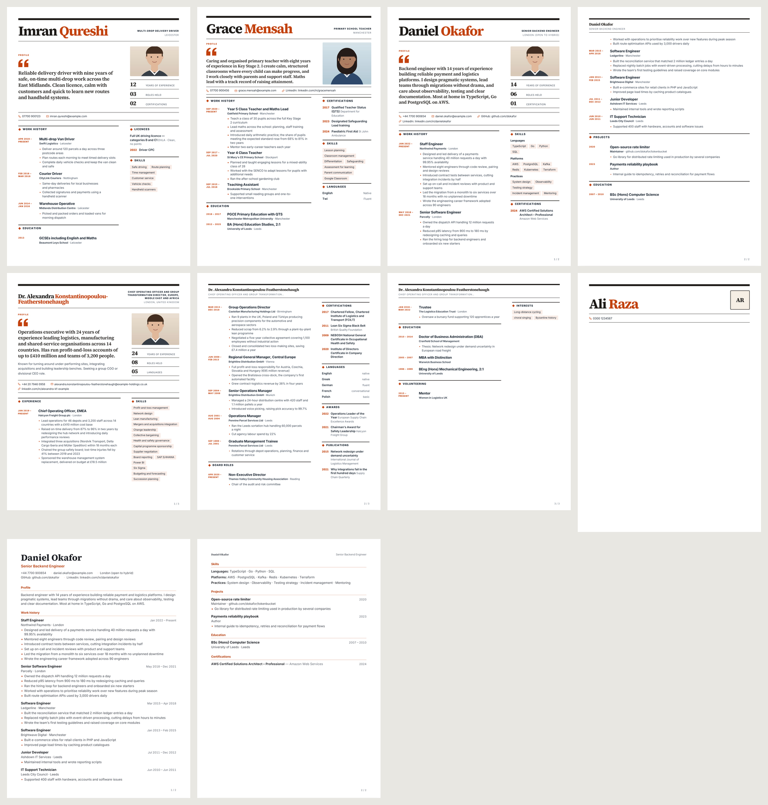

# Proposal: Byline (`byline`) — editorial statement front page

Scout run 2026-11-16 · branch `scout/2026-11-16` · status: **draft** (never live from this run)

## A. Concept

- **Name:** Byline. **Look label:** Editorial statement.
- **Audience:** senior and mid-career people whose profile matters — executives, managers, consultants, teachers and healthcare leads, communications and policy roles. People who want a page that looks *written*, not decorated.
- **Philosophy:** a magazine feature opening. A heavy rule and a ruled masthead carry the name (serif display, last name in the accent) with the role and place set right like a byline. Then the person's **own profile** is lifted out of the body and set as a large **pull-quote statement** — the first thing a recruiter reads after the name — beside a **caption column** with the portrait and the contact details, like a photo and its credit. Key numbers sit under the statement as a ruled row. The body below uses kicker rules (heavy rule over each section name) and dates in a hanging margin, with a narrow column for skills, languages and honours.
- **Why it deserves a place:** no design in the catalogue changes *content presentation* in the header: they all show the profile as body text. Byline makes the profile the hero, so the page leads with who the person is in their own words. Structurally it is an editorial front page (masthead → statement + caption column → ruled body), unlike any colour-field graphic header or the plain typographic headers of Folio/Press.

## B. References (inspiration only — nothing copied)

| Reference | Idea taken | How ours differs |
|---|---|---|
| [We and the Color — "Resume layout strategy: why this minimalist InDesign template is not your ordinary CV"](https://weandthecolor.com/resume-layout-strategy-why-this-minimalist-indesign-template-is-not-your-ordinary-cv/207469) | Treat a career "like a feature story rather than a data sheet"; serif heads over sans body | That template keeps a two-column split and a name header; ours lifts the profile into a pull-quote statement and adds a captioned portrait column |
| [Pepper IT — "Top 10 things we've learned designing annual reports that actually get read"](https://www.pepperit.com.au/?p=15584) | A "by the numbers" spread with commentary beside the figures | Our key numbers are a ruled row directly under the statement — only the person's real figures, never invented |
| [Smashing Magazine — Lessons from Swiss style](https://smashingmagazine.com/2009/07/lessons-from-swiss-style-graphic-design) | Rules as structure; asymmetric text block against a narrow column | The masthead rules and kicker rules on every section |
| Newspaper and magazine practice (masthead, byline, pull-quote, photo caption) | Generic editorial conventions | Composed for a CV: no newspaper name, no columns of filler, every word is the person's own |

## C. Preview

Contact sheet (engine render: short, typical, long, dense, sparse, ATS):

Pages: [short](byline/byline-short-p1.png) · [typical](byline/byline-typical-p1.png) · [long p1](byline/byline-long-p1.png) · [long p2](byline/byline-long-p2.png) · [dense p1](byline/byline-dense-p1.png) · [dense p2](byline/byline-dense-p2.png) · [dense p3](byline/byline-dense-p3.png) · [sparse](byline/byline-sparse-p1.png) · [ATS p1](byline/byline-ats-p1.png) · [ATS p2](byline/byline-ats-p2.png)

## D. Engine plan

- **Route 2**, a new building block `statement`, then a design file.
  - `src/modules/templates/graphic/statement.tsx` exports `statementTemplate(config)`; reuses `SplitName`, `Portrait`, `KeyNumbers`, `graphicHooks()` and `GRAPHIC_BASE_CSS`. The header reads the summary section from `RenderModel` (no new data) and the body hides the summary blocks so the text is not repeated. The statement steps down in size with its length (`statementScale`). With no profile, the header becomes a quiet masthead with the portrait and contacts in a row.
  - `spec.ts`: `GRAPHIC_BLOCKS.statement` with closed lists — `frame` (rect, arch, circle, tall, stamp), `art` = how the statement opens (marks, bar, drop), `numbers` (ruled, column) — plus `side` (caption column left/right), `marker`, `skills`, `caps`, `stop`, `ink`, `soft`.
  - `compose-graphic.ts`, `distinctness.ts` (own signature), `samples.ts` (`randomGraphic`, `enumSweep`).
  - Design file `src/modules/design/data/byline.json`: frame `rect`, art `marks`, numbers `ruled`, side `right`, marker `square`, skills `segments`, font pair `editorial`, accent `#c2410c`, ink `#1c1917`, soft `#f5efe6`.
- Shares the two engine fixes listed in the Tessera proposal (graphic detection in Instant Makeover; data-design typing).
- **Risks:** a very long profile (600+ characters) makes a small statement and pushes the first job lower (the 62% budget passes on all samples); the profile is shown once, in the header, so the body has no "Profile" section — the kicker above the statement keeps the section name for readers and parsers. Photo-less CVs get an initials block in the caption column.

## E. Uniqueness

- **Nearest by the distinctness tool:** Coral / Magenta at **0.848**.
- **Nearest by eye:** *Folio* (editorial, sidebar right, split header) and *Press* (refined editorial, label column). Both present the profile as body copy under a plain name header; neither has a masthead rule system, a statement block, a caption column with the portrait, or hanging dates.
- **Structurally new:** header architecture (ruled masthead + statement/caption split), content presentation (the profile as the hero pull-quote), kicker-ruled sections and hanging-margin dates.
- `structureKey`: "ruled editorial masthead with hoisted pull-quote statement and captioned portrait column".

## F. Scout's scores (honest)

| Criterion | Score | Notes |
|---|---|---|
| Visual sophistication | 9.0 | Feels like a magazine opener; restrained. |
| Originality | 9.0 | Content presentation is new in the catalogue; the body column is conventional. |
| Graphical quality | 8.8 | Quote mark is crisp vector art. Little graphic material overall; some will find it plain for a "graphic" design. |
| Typography | 9.2 | Serif display against sans body; the statement steps down cleanly with length. |
| Layout & hierarchy | 9.0 | Name → role → statement → numbers → work reads well. The aside column's top on page 1 starts beside the work history, fine. |
| Professional suitability | 9.3 | Suits conservative and senior fields as well as creative ones. |
| Engine compatibility | 9.2 | Route 2 block with options; all design:check steps pass. |
| Print/PDF quality | 9.0 | Parity, fonts, read-back pass. |
| **Average** | **9.06** | |

**Weaknesses:** sparse CV (name + phone only) looks empty — a masthead, an initials square and a phone number; the aside's skill chips can wrap long skills onto two lines; the continuation header is minimal.

## G. Implementation rounds (after approval)

| Round | Changes | Reviewer average | Lowest criteria |
|---|---|---|---|
| Review | — (approval review) | 8.25 | typography, layout, print capped at 8 |
| 1 | Contacts moved to a full-width dateline; quiet masthead for CVs without a profile; wider list column; near-black rules; edge cases (680-character and one-line profiles, Letter, themes) | 9.04 | graphical 8.8, layout 8.8 |
| 2 | Column top rules aligned; key numbers as a ruled caption column under the portrait; initials block; square chips; even list rows | 8.63 | graphical 8.0 and print 8.0 (clipped section markers) |
| 3 | Portrait flexes to balance the statement; whole markers; chips follow the accent; one-letter words bound to the next word | 9.0 | originality 8.8, graphical 8.7, layout 8.9 |
| 4 | Long profiles become statement + standfirst; statement held to the main column width; short statements centred | 9.04 | originality 8.7, graphical 8.8, layout 8.9 |

Status: **incomplete**. Every gate passes and the design looks professional, but the review converged at about 9.0. The reviewers named the limiting factor as the concept, not the polish: only the header is new, and the body is a conventional editorial column. See the blockers in the registry and in the day's report. Final page renders, edge cases and A4/Letter PDFs are in `byline/`, `byline/edge/` and `byline/pdf/`.
