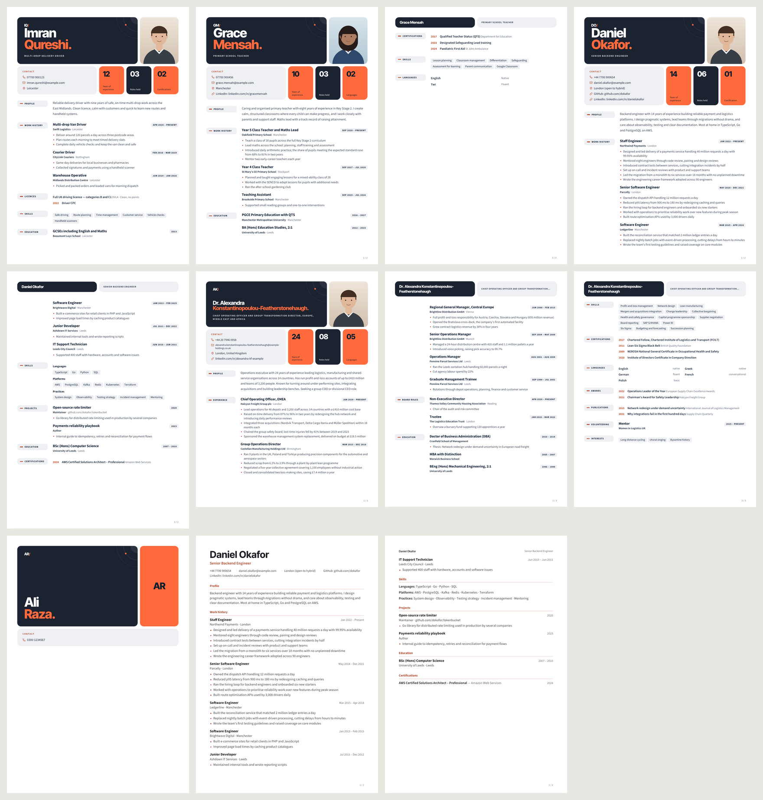

# Proposal: Tessera (`tessera`) — modular tile masthead

Scout run 2026-11-16 · branch `scout/2026-11-16` · status: **draft** (never live from this run)

## A. Concept

- **Name:** Tessera. **Look label:** Modular tiles.
- **Audience:** product, tech, design-adjacent and office roles; early-career people who have key numbers to show; anyone who wants a bold, contemporary page that still reads like a document.
- **Philosophy:** the identity is a *bento grid*: separate, self-contained tiles of different sizes, aligned to one 4-column grid with a single gutter. The biggest tile carries the name; the portrait has its own tile; contact details are a pale tile; each key number is a tile of its own. The body then drops all decoration except one idea carried down the page: every section name is a small **label tile** in a left gutter, sitting beside the first entry of its section. Dates sit in small pale pills on the right of each entry.
- **Why it deserves a place:** all 20 graphic designs in the catalogue share one architecture — a full-bleed dark header (poster, band, rail or cover) over a two-column body with a side column. Tessera has **no full-bleed band and no side column**: identity is broken into discrete tiles within the margins, and the body is a single labelled column. It is the first design whose graphic language is modular tiles rather than a coloured field.

## B. References (inspiration only — nothing copied)

| Reference | Idea taken | How ours differs |
|---|---|---|
| [Banani — "Bento grid" definition](https://banani.co/definitions/bento-grid) | Modules of different sizes on one grid, uniform gutters, size = priority | Applied to a printed CV header; tile sizes map to the CV hierarchy (name > portrait > contact > figures) |
| [Framer — "Bento CV" web template](https://framer.com/templates/bento-cv/) | That a personal profile can be told in tiles | Web portfolio, not a print CV; we use no layout, artwork or wording from it; ours is an A4/Letter document with a paginated labelled body |
| [Contra — "Joobin Job Seeker — Bento Design" (UIGO Studio)](https://contra.com/p/WMeOrBkc-joobin-job-seeker-bento-design) | Bento tiles for job-seeker information | App UI; ours keeps the tiles to the header and turns the body into a document column |
| [Smashing Magazine — Lessons from Swiss style](https://smashingmagazine.com/2009/07/lessons-from-swiss-style-graphic-design) | One modular grid governing every element; asymmetric balance | The 4-column header grid and the fixed label gutter below it |

## C. Preview

Contact sheet (engine render: short, typical, long, dense, sparse, ATS):

Pages: [short](tessera/tessera-short-p1.png) · [typical p1](tessera/tessera-typical-p1.png) · [typical p2](tessera/tessera-typical-p2.png) · [long p1](tessera/tessera-long-p1.png) · [long p2](tessera/tessera-long-p2.png) · [dense p1](tessera/tessera-dense-p1.png) · [dense p2](tessera/tessera-dense-p2.png) · [dense p3](tessera/tessera-dense-p3.png) · [sparse](tessera/tessera-sparse-p1.png) · [ATS p1](tessera/tessera-ats-p1.png) · [ATS p2](tessera/tessera-ats-p2.png)

## D. Engine plan

- **Route 2**, a new building block `bento`, then a design file.
  - `src/modules/templates/graphic/bento.tsx` exports `bentoTemplate(config)`; reuses `SplitName`, `Portrait`, `KeyNumbers`, `Monogram`, `graphicHooks()` and `GRAPHIC_BASE_CSS`. Adds a `label` hook (the engine's label-column mechanism in `blocks.tsx`) so each label tile takes real space beside the first block of its section.
  - `spec.ts`: `GRAPHIC_BLOCKS.bento` with closed lists — `frame` (fill, circle, arch, cut, pill), `art` (orbit, grid, quarter, stripes, none), `numbers` (accent, ink, outline), `corners` (round, soft, square) — plus the shared `marker`, `skills`, `caps`, `stop`, `ink`, `soft`.
  - `compose-graphic.ts` maps it; `distinctness.ts` gives it its own signature; `samples.ts` adds it to `randomGraphic` and `enumSweep`.
  - Design file `src/modules/design/data/tessera.json`: frame `fill`, art `orbit`, numbers `accent`, corners `round`, marker `bar`, skills `bars`, font pair `bold`, accent `#ff6a3d`, ink `#1b2230`, soft `#eef0f4`. `spec.layout.type` is `label-column` (it is one).
- **Fixes found while building (engine, behaviour-neutral for existing designs):**
  - `makeover/rank.ts` recognised graphic designs only by the hand-built list, so a graphic design added as a data file could become the first Instant Makeover pick (gap-audit G-09 test failed). It now uses the catalogue family.
  - `designs.ts`: the data-design spreads were typed `Record<string, …>`, so `tsc` failed as soon as any data design existed. Typed by the data-design ids.
- **Risks:** the label tiles wrap for long section names in a narrow gutter, so a geometry-sorted PDF extraction can interleave a two-line label with the entry beside it (same property as the live label-column designs; the design is labelled Creative and keeps the plain ATS version). Without key numbers the contact tile spans the full row (handled). Without a photo the portrait tile becomes an initials tile in the accent colour.

## E. Uniqueness

- **Nearest by the distinctness tool:** Aurora / Electric at **0.848** (the tool compares against graphic signatures; a data-built graphic layout differs in layout, header, headings, entries, placement and numbers).
- **Nearest by eye:** *Pulse* (bold band + cards) and *Press / Ledger* (label-column). Pulse has a full-width angled band and section cards; Press/Ledger have plain typographic headers. None has a modular tile header, and no graphic design has a single labelled column.
- **Structurally new:** header architecture (tile grid instead of a colour field), hierarchy expressed through tile size, key numbers as independent tiles, section names as label tiles in a gutter, no side column on any page.
- `structureKey`: "modular bento tile masthead over a gutter-labelled single column".

## F. Scout's scores (honest)

| Criterion | Score | Notes |
|---|---|---|
| Visual sophistication | 8.8 | Clear single idea; the tile header is striking. The body below is calm, perhaps too plain against the header. |
| Originality | 9.0 | New architecture for the catalogue; bento is a known web trend, rarer on print CVs. |
| Graphical quality | 8.8 | Orbit art is restrained; the stat tiles' labels are small and pinned to the tile bottom, leaving a gap under the figure. |
| Typography | 8.8 | Strong name; label tiles at 7.6 pt caps are small. |
| Layout & hierarchy | 9.0 | Reads name → role → contact → numbers → sections. The typical CV runs to 2 pages where Neon takes 1 (the labelled column is less dense). |
| Professional suitability | 8.8 | Good for tech/product/creative; too bold for conservative fields. |
| Engine compatibility | 9.2 | Route 2 block with options; all design:check steps pass. |
| Print/PDF quality | 9.0 | Parity and fonts pass; label-column extraction order is "Creative". |
| **Average** | **8.93** | |

**Weaknesses:** typical teacher CV spills to a 2nd page with little on it; long section names ("Registration & certifications") wrap to 2–3 lines in the label tile; continuation-page header is plain.
