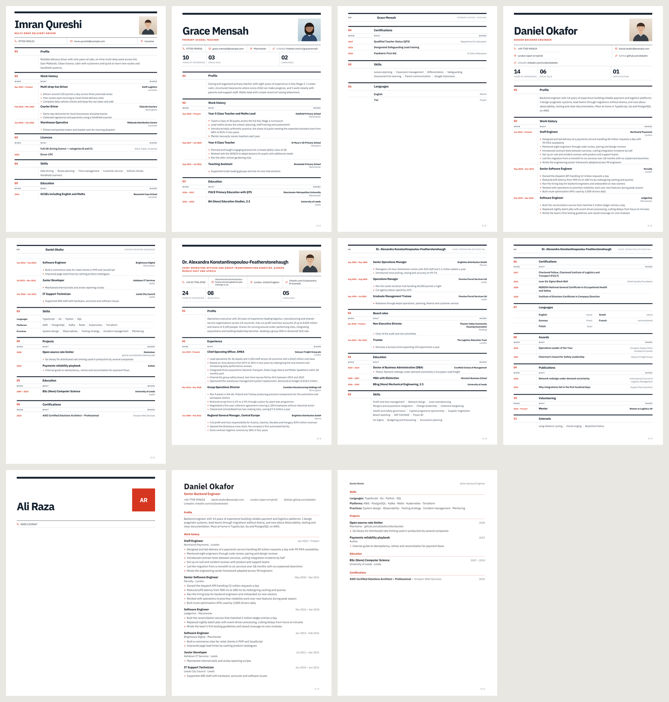
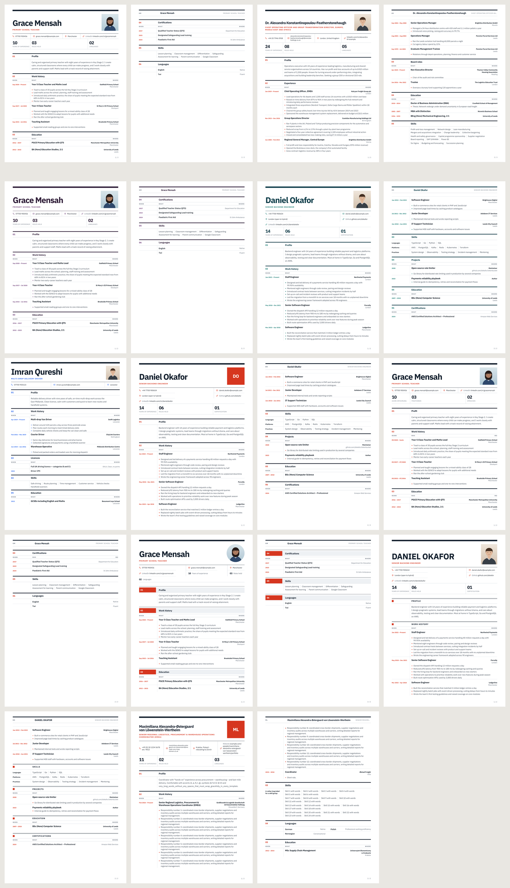

# Premium CV Template Scout: report for 2026-11-17

**Outcome:** 1 proposal built and reviewed. **Tabula** was **REJECTED** (reviewer average 7.19). No design was merged. This is a **shortfall**: no exceptional design today. Only one candidate was shortlisted, because the second-best idea (Gloss) failed the whole-template body rule before building, and the quota was not filled with it.

- Tabula's building block and design file stay on branch [`scout/2026-11-17`](https://github.com/nisar87/AI_CV_Studio_Redesign/tree/scout/2026-11-17) for reference. No PR was opened, since the design was not approved.
- This report, the proposal with its previews and PDFs, and the registry are merged to `main` as documentation only.
- CI on `main` was green at the start of the run (1fb91d2).

## 1. Gaps found before research

- **Body structures in the catalogue** (from the registry's signatures): single column, sidebar, label column (Ledger, Press), dates-left gutter (Linea, Scholar), timeline dots, two-equal and rails grids, and the graphic timeline with a side column. Every body is a stack of entries.
- **Learnings from 2026-11-16:** a new header over an existing body is not new (Tessera). Design the body with the same care as the header (Byline).
- **Professions** still thin: healthcare, trades, academic, operations and public sector in a graphic look.
- **Engine fact that limits body ideas:** the paginator stacks blocks per column and adds up their heights. Text cannot flow between columns, and a job's bullets are separate blocks, so it cannot keep an alternating side.

## 2. Candidates (8 researched, 1 shortlisted)

| Candidate | structureKey | Result |
|---|---|---|
| **Tabula** | fact table masthead over ruled column-headed tables for every section | shortlisted → built → **rejected** by the reviewer |
| Gloss | title page with margin-note contacts over a text column with per-entry outer-margin notes | dropped by the scout: meta in a margin is the Linea/Press body family, mirrored |
| Evidence | impact-first entries with a pulled key figure beside each role | dropped: picking figures from free text is unreliable ("Year 5") |
| Playbill | centred programme title page over dotted-leader listings | dropped: dates-right re-decorated, Regent/Heritage header |
| Broadsheet | newspaper nameplate over two balanced flowing text columns | dropped: the paginator cannot flow text between columns |
| Axis | centre spine with alternating left and right entries | dropped: bullets can't keep their side; a common template-shop look |
| Thumb index | outer edge thumb-index tabs as section heads | recorded as a **header/heading variant** only |
| Wall label | museum tombstone captions as entries | dropped: the stacked entry with caption typography |

`npx tsx scripts/scout-registry.tsx --check` passes: no repeated structure keys.

## 3. Tabula: the CV as an information table (REJECTED)

- **Idea:** one three-column grid (when | what | where) through every page.
  - A fact-table header: contact cells, and key numbers on the grid lines.
  - Every section is a numbered table with a "When · What · Where" column-head row. Entries are ruled rows; descriptions span two columns; a vertical hairline runs down the key column.
  - Lists, skills and languages are rows of the same table.
  - Aimed at engineering, operations, trades and the public sector.
- **References:** [SBB design manual (SEGD)](https://segd.org/resources/design-manual-swiss-federal-railways/), [eguide.ch: SBB visual information](https://www.eguide.ch/en/objekt/sbb/), [Tufte: resumes and presentation of data](https://www.edwardtufte.com/notebook/resumes-and-presentation-of-data/).
- **Built (Route 2):**
  - A new `table` graphic building block with options: frame square/circle/tall; opener heavy/double/band; numbers cells/inline; marker; caps.
  - Its column heads are in every CV language and flattened as PDF furniture.
  - `randomGraphic` takes the layout without an extra random draw.
- **Gates:** `design:check` PASS on every step; distinctness 0.818 from Linea. `vitest` 583 passed, with render identity unchanged. tsc, eslint and prettier clean. Fonts are embedded as CID TrueType on A4 and Letter.
- **Uniqueness (scout):** header nearest Ledger/Linea; body nearest Linea/Scholar (dates left) and Ledger/Press (label column); continuation nearest the rule + name strips. Full table in [tabula.md](tabula.md).
- **Scores:**

| | Vis | Orig | Graph | Type | Layout | Prof | Engine | Print | **Avg** |
|---|---|---|---|---|---|---|---|---|---|
| Scout | 8.5 | 8.5 | 8.0 | 8.5 | 9.0 | 9.0 | 9.0 | 9.0 | **8.69** |
| **Reviewer** | 6.5 | 6.0 | 6.0 | 7.5 | 7.5 | 8.5 | 7.5 | 8.0 | **7.19** |

- **Reviewer's reasons (REJECT):**
  1. **Body:** it is a rearranged existing body. Each row is Linea's or Scholar's dates-left entry with the organisation moved right; Ledger already has numbered heads; the skill lists are as in Brief and Clarity. Ruled date | role | company rows are common in template shops, and the column-head row is typographic dressing.
  2. **Header:** a big name, a ruled contact strip and key-number cells. That is the Blueprint, Cyber and Ocean family, and close to the rejected swiss-poster.
  3. **Continuation pages:** they don't do what the proposal claimed. A section that continues onto a new page doesn't repeat its heads. The running strip's name sits off the grid, and long roles are cut short with "…". *(The scout's claim was wrong and has been corrected in the proposal.)*
  4. **Defects:**
     - the typical CV spills onto a page 2 that is about 40% full;
     - the key-number cells are unequal;
     - the band option leaves one stat orphaned on its own row;
     - the email breaks mid-word on the extreme CV.
  5. **Look:** it reads as an ATS-family document, and the colour themes barely show.
- **The reviewer's suggested future:** keep the table rows as a possible **entry-style option** on an existing block (registry `kind: entry-variant`), not as a new design.

## 4. Implementation status

Not implemented, because the design was not approved. Tabula's files (`graphic/table.tsx`, the spec, composer, distinctness and samples changes, `data/tabula.json`, the thumbnail and its fingerprint) are only on branch `scout/2026-11-17` and are **not** merged.

## 5. Remaining issues and open items for the owner

- Two runs in a row have ended without a design. Both failed on the same point: **the body is not structurally new**. Inside this engine's stacked-block model, real body novelty is hard. The owner may want to decide whether the scout should:
  - propose engine-level body capabilities (for example sections that sit side by side, or a section continuation head on later pages);
  - or accept entry- and heading-level variants as options on existing blocks instead of new designs.
- Byline's PR #1 is still open from the previous run.

## 6. Registry changes

- 8 proposals added:
  - `tabula`: rejected, with the reviewer's reasons and both score sets; kept as `kind: entry-variant`.
  - `thumb-index`: recorded as a header variant.
  - 6 dropped by the scout, each with the reason (`gloss`, `evidence`, `playbill`, `broadsheet`, `axis`, `museum-label`).
- 3 learnings added:
  - ruled rows are dressing, not structure;
  - check every claimed zone, the page fill and the option variants before review;
  - the gaps that remain, plus engine notes: the Letter-size stress fixture, PDF furniture flattening, and adding a random layout without an extra draw.
- `existing` refreshed from `main`: 52 designs.
