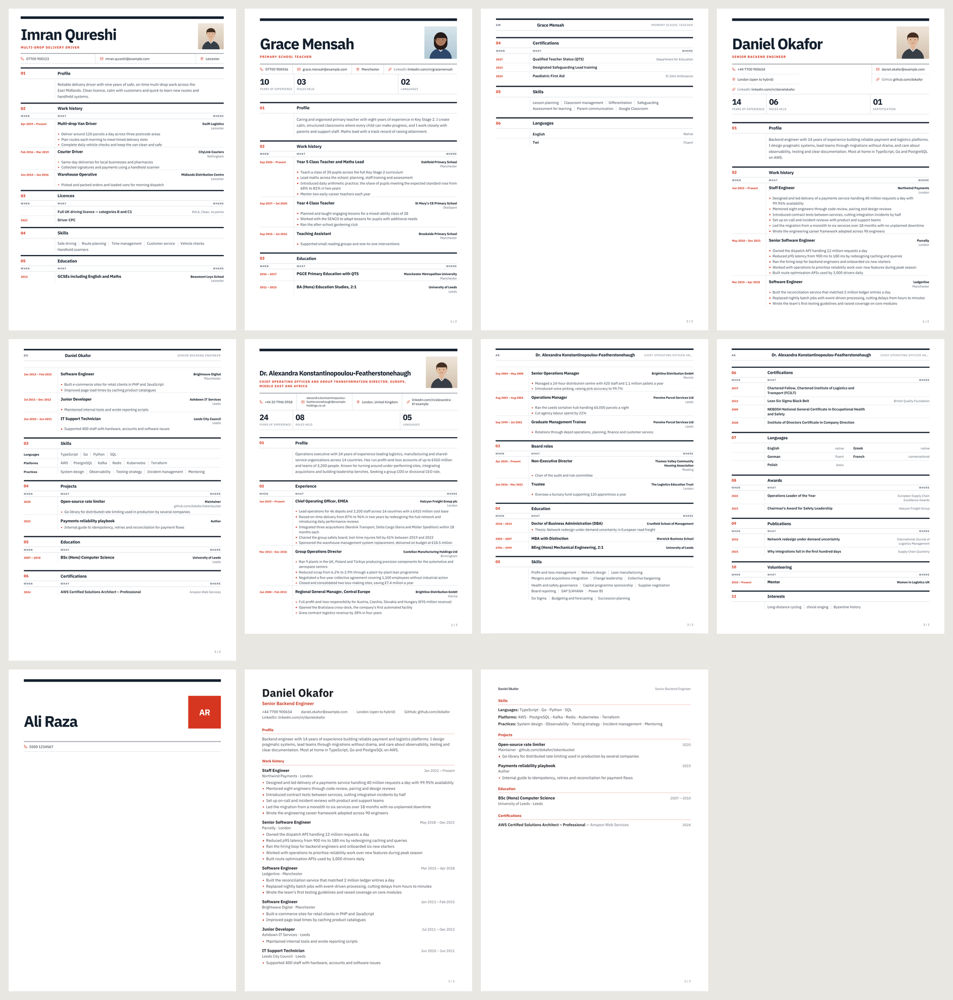
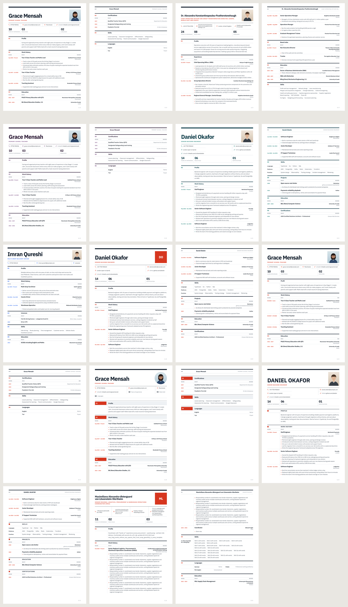

# Proposal: Tabula — the CV as an information table

Scout run 2026-11-17 · branch `scout/2026-11-17` · **REJECTED by the reviewer** (average 7.19). See [REPORT.md](REPORT.md).

## A. Concept

- **Name:** Tabula. **Style label:** Information table.
- **Audience:** engineering, operations, logistics, finance, public sector, IT, skilled trades and senior office roles: people whose recruiters scan for *when, what and where* and distrust decoration.
- **Philosophy:** the whole CV is set the way a timetable or an annual-report schedule sets facts. One three-column grid runs through every page:

  `key column (when) | content column (what) | right column (where)`

  - **Header:** a heavy rule, the name in heavy grotesque with the role as a signal-colour line, the portrait on the grid's right edge, then a **fact table**: contact details as ruled cells in one row, and the key numbers as large tabular figures whose cell rules sit on the body grid's column lines.
  - **Body:** every section is its own **table**: an opening rule, a section number in the key column and the title in the content column, then — for sections made of entries — a **column-header row** ("When · What · Where", in the CV's language). Each entry is a ruled row: dates in the key column, the role in the content column, organisation and place right-aligned in the right column; the description spans the content and right columns. A vertical hairline runs down the key column through every row. Certificates, awards and licences are one-line rows on the same columns. Skill groups put the group name in the key column and run the skills on with thin rules between. Languages are name/level pairs, two to a row.
  - **Continuation pages:** a running strip on the same grid (initials in the key column, name, role at the right edge), then the tables continue with their own rules and numbering.
- **Why it deserves a place:** no design in the catalogue presents content as tables. Every existing body is a flow of stacked entries (dates left or right, a timeline, a side column, or a label column). Tabula changes *how entries are read*: as rows under column heads, with the organisation in its own column. It also gives the graphic family its first sober, data-led look for the professions the catalogue serves least (trades, operations, public sector).

## B. References (inspiration only)

| Reference | Idea taken |
|---|---|
| [Müller-Brockmann, SBB design manual (SEGD)](https://segd.org/resources/design-manual-swiss-federal-railways/) | A strict information grid where every fact has a fixed column |
| [eguide.ch: SBB visual information system](https://www.eguide.ch/en/objekt/sbb/) | Timetable typography: tabular figures, hairlines, small column labels |
| [Tufte: resumes and presentation of data](https://www.edwardtufte.com/notebook/resumes-and-presentation-of-data/) | A CV as presentation of data rather than decoration |

No template, artwork, name or brand is reproduced; the composition (fact table, column-headed section tables, spanning description rows) is our own.

## C. Preview

Engine renders (`npx tsx scripts/design-preview.tsx tabula …`): short, typical, long (2 pages), dense executive (3 pages), sparse and the ATS version.

Edge cases: Letter (typical, dense), the plum and teal themes, a custom blue accent, no photo, German (column heads "Wann · Was · Wo"), the `band` opener with circle portrait and inline key numbers, the `double` opener with tall portrait, square marker and capitals, and the extreme CV.

PDFs (A4 and Letter, all five CVs) are in `tabula/pdf/`. All fonts are embedded as CID TrueType; no Type 3.

## D. Engine plan (Route 2, built)

- New layout module `src/modules/templates/graphic/table.tsx` (`tableTemplate(config)`), own hooks (row entry head, row list items, skill rows, language pairs, numbered table heads) and CSS on the fit variables.
- `spec.ts`: new `table` variant in `graphicSpec` and `GRAPHIC_BLOCKS` with closed options:
  - `frame`: square, circle, tall;
  - `art` (the table opener): heavy, double, band;
  - `numbers`: cells (own row of large figures on the grid) or inline (cells of the fact table);
  - plus `marker`, `skills` (language pips) and `caps`.
- `compose-graphic.ts` maps it; `distinctness.ts` gives it a signature; `samples.ts` adds it to `enumSweep` and to `randomGraphic` **without an extra random draw**, so every other random spec is unchanged.
- Column heads are printed in every CV language and shown by `html[lang]`; they are page furniture (flattened to a picture in the PDF), so an ATS never reads "When/What/Where". German words added to `cv-words.ts`.
- Design file `src/modules/design/data/tabula.json` (technical font pair, accent #d6361f, ink #14202e).
- **Risks:** the right column is 52 mm; a very long organisation name wraps (the read-back gate passes with it on its own line). Key numbers in the `cells` look sit on the body grid (key / content / right), so the first figure cell is narrow by design.

Gates: `npm run design:check -- tabula` PASS on every step (valid, registered, thumbnail, catalogue gates, composition gates, fingerprint, distinctness 0.818 from the nearest). `npx vitest run` 583 passed (render identity unchanged). `tsc`, eslint and prettier clean.

## E. Uniqueness, zone by zone

Tool distance from the nearest live design: **0.818 (Linea)**.

| Zone | Nearest existing | What differs |
|---|---|---|
| **Header** | Ledger / Linea (typographic name over a contact line) | The contact details are a ruled **fact table** of cells, and the key numbers sit as figures on the body's column lines. No existing header is a table; the graphic headers are colour fields. |
| **Body** | Linea / Scholar (dates in a left margin), Ledger / Press (label column) | Entries are **table rows under a column-header row**: the organisation and place get their own right column instead of a subtitle line; descriptions span two columns; a vertical rule runs down the key column; lists, skills and languages are rows of the same table. Linea's body is a stacked entry with a date gutter; Press/Ledger put *section names* in the margin. Neither has column heads, a third column or ruled rows. |
| **Continuation pages** | Byline-style rule + name strips (spot, statement) | The running strip is laid on the table grid (initials in the key column); a new section on a later page opens as a numbered table with its column heads. *Correction after review:* a section that **continues** from the previous page does not repeat its head or column heads (the paginator repeats only the running header), so this zone is weaker than first written. |

## F. Scout's scores (honest)

| Criterion | Score | Weakness |
|---|---|---|
| Visual sophistication | 8.5 | Restrained to the point of austerity; the strong idea is structural, not pictorial. |
| Originality | 8.5 | Tables are new to the catalogue, but a ruled "dates left" CV is a familiar genre in print. |
| Graphical quality | 8.0 | Only rules, figures and one signal colour; the `cells` key numbers leave the first cell narrow. |
| Typography | 8.5 | Clear scale; column heads at 6.6 pt are at the limit of furniture size. |
| Layout & hierarchy | 9.0 | Reads at a glance on 1–3 pages; the right column wraps long organisation names. |
| Professional suitability | 9.0 | Very credible for engineering, operations and public sector; may read cold for creative fields. |
| Engine compatibility | 9.0 | Route 2 block with options; every gate green. |
| Print/PDF quality | 9.0 | Fonts embedded; clean breaks on A4 and Letter. |
| **Average** | **8.69** | |
