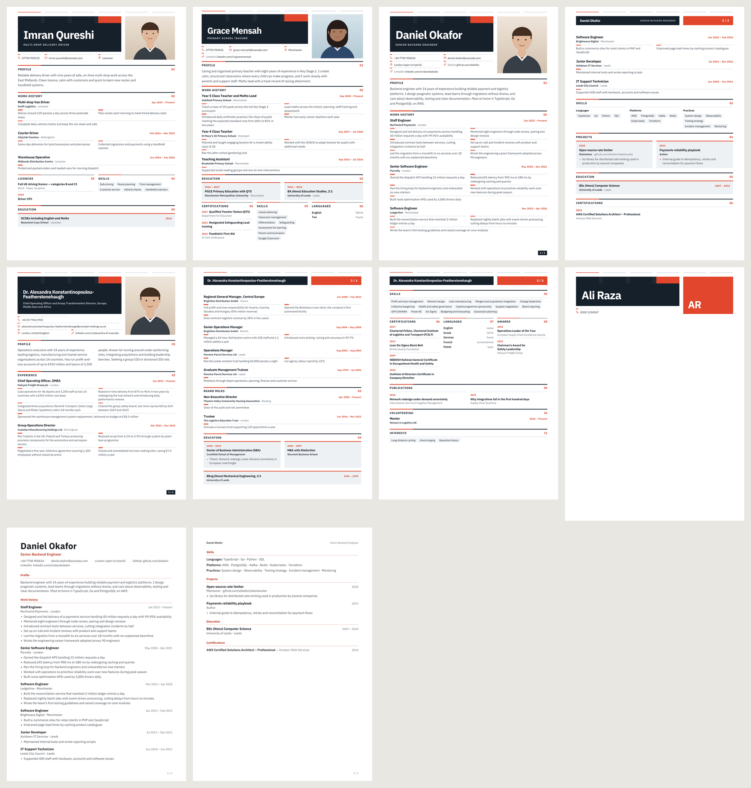
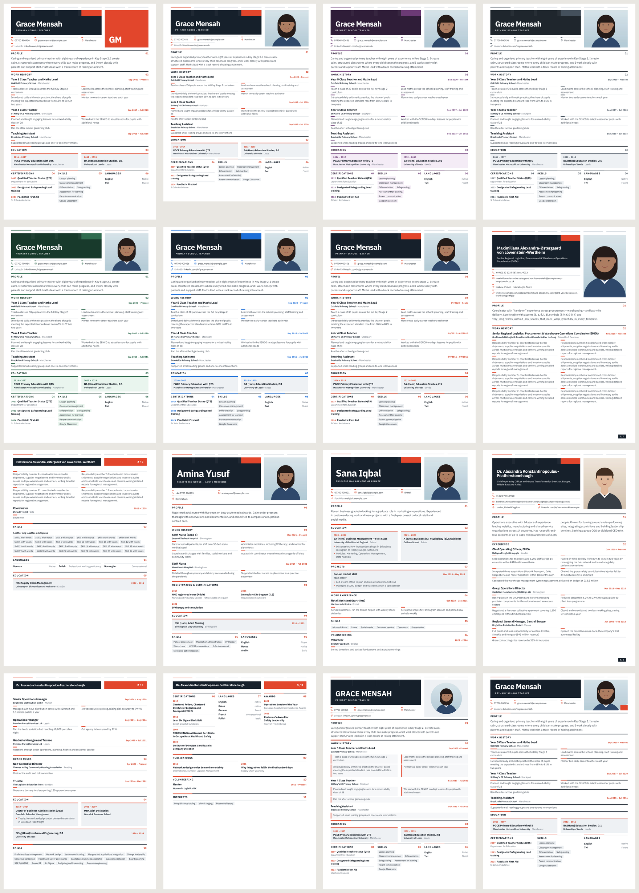

# Premium CV Template Scout: report for 2026-11-18

**Outcome:** 1 proposal built and reviewed. **Raster** was **APPROVED**, then marked **incomplete** after 4 review rounds (best average 8.66, last 8.61, against the 9.5 bar). No design was merged. This is a **shortfall**: only one candidate could plausibly reach 9.5, and the quota was not filled with a second.

- **Raster:** its building block, the design file and the engine changes are in draft PR [#6](https://github.com/nisar87/AI_CV_Studio_Redesign/pull/6). The PR stays open and must not be merged.
- **On `main`:** this report, the proposal with its previews and PDFs, and the registry, as documentation only.
- **CI on `main`:** green at the start of the run (6a99337).

## 1. Gaps found before research

- **Bodies:** every body in the catalogue is a stack of entries with bullet lists. The kinds are:
  - single column;
  - side column;
  - label column (Ledger, Press);
  - dates gutter (Linea, Scholar);
  - timeline;
  - two-equal and rails;
  - the graphic timeline beside a side column.
- **Learnings from the last two runs:**
  - Both ended on "the body is not structurally new" (Tessera, Byline, Tabula).
  - Real body novelty must change what a block shows or how columns relate. Ruling a stacked entry differently is not enough.
- **Professions:** healthcare, trades and academic are still thin in a graphic look.

## 2. Candidates (8 researched, 1 shortlisted)

| Candidate | structureKey | Result |
|---|---|---|
| **Raster** | two module masthead over a modular grid body with achievement tiles and half width entry modules | shortlisted → **approved** → **incomplete** |
| Lexicon | run in headword header over run in paragraph entries | dropped: points set as prose are slow to scan, and it has almost no graphic language |
| Pillars | jobs as side by side columns three to a row | dropped: a sibling of Raster, and too narrow for real job descriptions |
| Lead story | newspaper story entries with two column justified points | dropped: the Byline family, and the columns scan poorly |
| Tenure bars | tenure proportional bars beside each role | dropped: needs free-text date parsing, and draws a number the person did not write |
| Periodic | skills as periodic table element tiles | dropped: would invent symbols |
| Spreads | mirrored verso recto pages with outer edge side column | recorded as a **continuation variant** only |
| Wayfinding | signage panel section heads with pictograms over a single column | recorded as a **heading variant** only |

`npx tsx scripts/scout-registry.tsx --check` passes.

## 3. Raster: the CV set on a visible modular grid (APPROVED → INCOMPLETE)

**Idea:** everything snaps to one six-column grid, and the CV is built from modules.

- **Header:** a name module (columns 1–4) and contact modules sit beside a portrait module that spans both rows.
- **Body:**
  - a job's points are tiles, two to a row;
  - education, projects and similar entries are half-width modules;
  - short sections (certificates, skills, languages) share a row as modules.
- **Grid ruler:** six module bars in the top margin of every page.
- **Continuation pages:** each opens with a name strip and a page module ("2 / 3").

**References:**
- [Müller-Brockmann, *Grid Systems* (Niggli)](https://niggli.ch/en/grid-systems-in-graphic-design.html)
- [Unigrids (Vignelli, NPS)](https://en.wikipedia.org/wiki/Unigrids)
- [IxDF: grid systems](https://ixdf.org/literature/article/how-to-use-grid-systems)
- [Navig8: annual report highlights](https://wearenavig8.squarespace.com/knowledge-comment/2024/1/17/annual-report-design-the-years-highlights-7s55h)

**Built (Route 2):**
- A new `raster` graphic building block with these options:
  - `frame`: square, circle, notch;
  - `art`: solid, lines, corner;
  - `tiles`: rule, field, bar;
  - plus marker, skills, caps, ink and soft.
- Three optional body capabilities in the shared block builder. No existing design uses them, and render identity is unchanged.
  - `bulletRow`: points n to a row, one block per row.
  - `entryRow`: entries n to a row.
  - `sectionRow`: short consecutive sections share a row.
- `randomGraphic` and `enumSweep` include the layout without an extra random draw.

**Uniqueness** (full table in [raster.md](raster.md)):
- **Body:** new. No design or past proposal sets points as tiles or entries and sections as modules. Nearest: Grid/Tiles and Mosaic/Matrix, which use fixed section columns.
- **Continuation:** new. The page number is a module of the grid.
- **Header:** the weakest zone. It is near the poster family.
- The distinctness tool puts it 0.788 from the nearest designs.

**Scores:**

| Round | Vis | Orig | Graph | Type | Layout | Prof | Engine | Print | **Avg** |
|---|---|---|---|---|---|---|---|---|---|
| Scout | 8.5 | 8.5 | 8.5 | 8.5 | 8.5 | 9.0 | 9.0 | 9.0 | **8.69** |
| Approval | 8.0 | 8.0 | 7.5 | 8.0 | 8.0 | 8.5 | 8.0 | 8.0 | **8.00** |
| 1 | 8.6 | 8.3 | 8.5 | 8.7 | 8.0* | 8.8 | 9.2 | 9.2 | **8.66** |
| 2 | 8.6 | 8.5 | 8.5 | 8.7 | 8.0* | 8.8 | 8.0* | 9.0 | **8.51** |
| 3 | 8.6 | 8.3 | 8.0* | 8.6 | 8.2 | 9.0 | 9.0 | 8.8 | **8.56** |
| 4 | 8.5 | 8.3 | 8.5 | 8.8 | 8.0* | 9.0 | 9.0 | 8.8 | **8.61** |

\* Capped at 8 by a visible defect:
- round 1: half-empty tile rows;
- round 2: clipped text at page feet;
- round 3: art under the name;
- round 4: continued points without context.

Every round used a fresh reviewer agent that scored from the renders and PDFs only.

**Reviewer's approval reason:**
- The body is structurally new: points as tiles, entries and short sections as modules. It fills the gap the earlier learnings name.
- The continuation pages are new too.
- The header is the weak zone but acceptable.
- It is sober enough for engineering, operations, healthcare and trades.

**Why it is incomplete:** the rounds converged at 8.5–8.7, and the round 3 and round 4 reviewers both said the gap is mainly the concept. Bullets in two columns still read as one column. The header (a dark block beside a photo) and the openers (a heavy rule with a number) are conventional. Points carried to a new page lose their job context. Polish was not going to reach 9.5, so the fifth round was not spent.

**Gates on the final build:**
- `design:check`: every step PASS (validity, registration, thumbnail, catalogue gates, composition gates, fingerprint, distinctness).
- `vitest`: 781 passed. Render identity is unchanged. tsc and prettier are clean.
- A page-foot overflow check over 10 CVs × A4/Letter found no overflow.
- PDFs embed IBM Plex as CID TrueType, with no Type 3. Page counts match the previews on A4 and Letter (typical CV: 1 page on both).
- CI on PR #6: see the PR. The first push failed on a real engine bug, fixed on the branch: the first design file on `main` broke the Playwright step, because the generated design index imported JSON without `{ type: 'json' }`.

## 4. Implementation status

Not merged. The design files (`graphic/raster.tsx`, `data/raster.json`, the thumbnail and its fingerprint) and the engine changes (the three body capabilities, the spec/composer/distinctness/samples wiring and the design-index fix) are only on `scout/2026-11-18` / PR #6.

## 5. Remaining issues and open items for the owner

- **Raster's blockers** (also in the registry):
  1. the concept ceiling of a one-column body with paired points;
  2. no "continued" context for points carried to a new page (the engine only repeats the running header);
  3. blank page feet where tile rows are kept whole;
  4. uneven tile and module rows;
  5. weak header art.
- **Worth keeping even if Raster is closed:**
  - the design-index JSON import fix. Without it, the first data design on `main` breaks e2e;
  - `bulletRow`, `entryRow` and `sectionRow` as reusable body capabilities.
- **Three runs, no design.** The owner may want to decide whether the scout should first propose engine capabilities that make a body truly modular: for example a section "continued" head on later pages, or sections that sit side by side across the whole page.
- PR #1 (Byline) is still open from 2026-11-16.

## 6. Registry changes

- **8 proposals added:**
  - `raster`: incomplete, with the approval reason, all round scores, the blockers and the PR link;
  - `lexicon`, `pillars`, `lead-story`, `tenure-bars` and `periodic`: dropped, each with its reason;
  - `spreads`: kept as `kind: continuation-variant`;
  - `wayfinding`: kept as `kind: heading-variant`.
- **3 learnings added:**
  - a new body was approved, but it needs the grid to shape the header and openers and to page-break gracefully;
  - engine lessons (numbers filled in after measuring, the two-column profile read-back, the JSON import attribute, the reusable capabilities);
  - the gaps still open.
- **`existing`:** refreshed from `main`, 52 designs.
