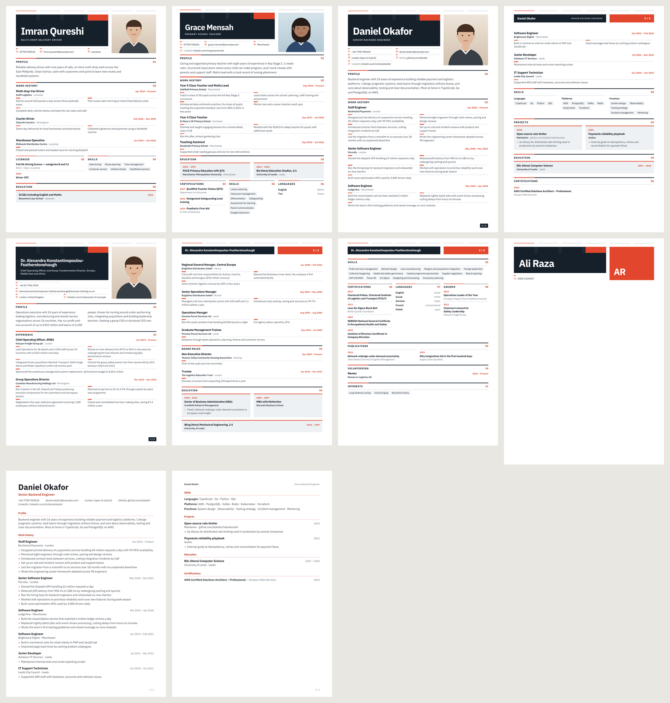
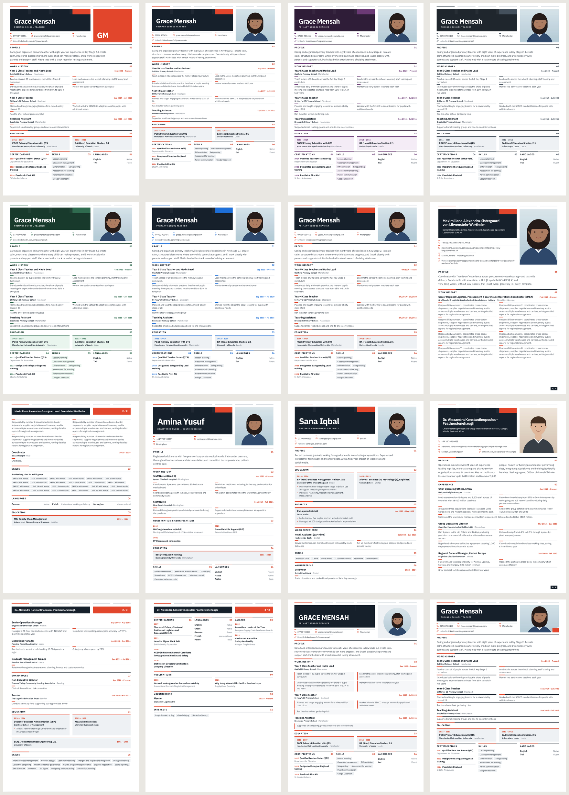

# Raster: the CV set on a visible modular grid

Scout proposal, 2026-11-18. Decision: **APPROVED**, then **INCOMPLETE** after 4 review rounds (best average 8.66). The design is a draft in the open PR [#6](https://github.com/nisar87/AI_CV_Studio_Redesign/pull/6), which must not be merged.

## A. Concept

- **Name:** Raster (German *Raster*, the Swiss word for a layout grid).
- **Audience:** engineering, product, operations, project and programme managers, architects and designers; also clear enough for healthcare and the trades.
- **Idea in one sentence:** everything on the page snaps to one six-column modular grid, and the CV is built from **modules** instead of a stack of entries.
- **The three zones:**
  1. **Header (page 1):** a row of two modules. A solid colour module over columns 1–4 carries the name and role, with its own column gutters showing faintly and one accent module in its corner. A portrait module over columns 5–6 has the same height (a hot-colour initials module when there is no photo). Under it, each contact item takes one to four modules by its length, opened by a ruled module edge and an accent tick. Every page carries a grid ruler in the top margin: six module ticks, the first in the accent.
  2. **Body:**
     - A job's points are **tiles, two to a row**, each opened by a short accent rule over a hairline. An odd last point spans the row. A lone module always spans its row.
     - Education, projects, publications, references and similar entries are **half-width modules side by side**, on a pale field with an accent top edge.
     - **Short sections share a row as modules**: certificates, skills, languages, licences and awards sit two or three to a row, each with its own heading. A longer section (for example three skill groups) gets a full row of three modules instead.
     - Section openers are a heavy ink rule whose first module is the accent, with the title in tracked capitals and the section number at the right end.
     - A long profile is set as two columns of three modules each. A short profile sits in columns 1–4.
  3. **Continuation pages:** every page opens with the same two-module row in small: a name strip over columns 1–4 and a **page module** over columns 5–6 that carries the page number ("2 / 3"). Tiles and modules continue on the same grid.
- **Why it deserves a place:** every body in the catalogue is a stack of entries with bullet lists (single column, side column, label column, dates gutter, timeline, two-equal or rails). Raster's body is a grid of modules in both directions: points as tiles, entries as modules, sections as modules. It is bold enough to read as a graphic design, but stays sober enough for senior and technical roles.

## B. References (inspiration only)

| Reference | Idea taken | How Raster differs |
|---|---|---|
| [Josef Müller-Brockmann, *Grid Systems in Graphic Design* (Niggli)](https://niggli.ch/en/grid-systems-in-graphic-design.html) | A modular grid in which every element occupies whole module fields | Applied to CV content units: a point, an entry and a short section are each a module |
| [Unigrids (Vignelli, US National Park Service)](https://en.wikipedia.org/wiki/Unigrids) | A strong solid title band, with content in standard panels of one system | The title band is one module beside a portrait module, not a full-width band |
| [IxDF: how to use grid systems](https://ixdf.org/literature/article/how-to-use-grid-systems) | Modular grids versus column grids: content snaps to modules in both directions | Rows of tiles and modules, not columns of text |
| [Navig8: annual report design, the year's highlights](https://wearenavig8.squarespace.com/knowledge-comment/2024/1/17/annual-report-design-the-years-highlights-7s55h) | Highlights set as separate tiles rather than a list | Uses the person's own points; no numbers are invented |

No template, artwork, name or brand is copied.

## C. Preview

All renders come from the engine (`scripts/design-preview.tsx`). PDFs for A4 and Letter are in [`raster/pdf/`](raster/pdf/).

Edge cases:
- no photo;
- Letter;
- the plum, graphite and forest themes;
- a custom accent;
- German;
- the extreme CV;
- the nurse and graduate CVs;
- dense A4;
- two option sets (circle / lines / field tiles / numbered caps headings, and notch / solid / bar tiles / bar marker).

## D. Engine plan (Route 2, built)

- **New layout module:** `src/modules/templates/graphic/raster.tsx` (`rasterTemplate(config)`). It reuses `graphicHooks`, `nameScale`, `Portrait`, `ContactIcon` and `GRAPHIC_BASE_CSS`.
- **Spec:** a new `raster` variant in `graphicSpec`, plus `GRAPHIC_BLOCKS.raster` with closed option lists:
  - `frame`: square, circle, notch;
  - `art`: solid, lines, corner;
  - `tiles`: rule, field, bar;
  - plus `marker`, `skills`, `caps`, `ink` and `soft`.
- **Composer, distinctness and samples:**
  - `compose-graphic.ts` maps the block to its config.
  - `distinctness.ts` gives it its own signature (`module-grid` with `point-tiles+entry-modules`).
  - `samples.ts` adds it to `randomGraphic` without an extra random draw (every other random spec is unchanged) and to `enumSweep`.
- **Three optional body capabilities in the shared block builder.** Each is used only when a template asks for it; render identity of all 52 designs is unchanged.
  - `hooks.bulletRow`: per section kind, a job's points are grouped n to a row. Each row is one pagination block, and the job's heading carries the first row. Up to two rows stay whole; longer jobs break between rows and never leave a single row alone.
  - `hooks.entryRow`: per section kind, entries sit n to a row, each whole. A row is one block, and pages break between rows.
  - `hooks.sectionRow`: consecutive short sections of the listed kinds share one block as side-by-side modules, each with its own heading. This happens only for sections with 6 entries or fewer; other sections stay full width.

  `flowBlocks()` in `blocks.tsx` builds the main column. Without `sectionRow` it is exactly the old `flatMap(sectionBlocks)`.
- **Design file:** `src/modules/design/data/raster.json`. It is a draft; its fallback is Neon.
- **Gates:**
  - `npm run design:check -- raster`: every step PASS (validity, registration, thumbnail, catalogue gates, composition gates, fingerprint, distinctness 0.788 from the nearest).
  - `npx vitest run`: all pass. Render identity is unchanged.
  - Fonts are embedded as CID TrueType, with no Type 3.
- **Risks:**
  - A single-column modular body uses more height than side-column designs. The typical CV fits A4 only after the engine's last fit step, and needs 2 pages on Letter. Spark and Pulse (live) do the same.
  - A section row is one unbreakable block. It is capped at 6 entries per section.

## E. Uniqueness, zone by zone

| Zone | Nearest existing / past | What differs |
|---|---|---|
| **Header** | Poster family (Neon, Coral…): a dark field with the name and a framed portrait inside it. The rejected Tabula header (contact cells). | Two separate modules side by side on the grid, with a gutter between them. The portrait is a module of the grid, not a frame standing on art. Contacts sit on a single ruled line, not in boxed cells, and there are no key numbers. |
| **Body** | Grid / Tiles (two-equal) and Mosaic / Matrix (rails) put whole sections in fixed columns. Every design sets points as a vertical bullet list. Tabula set ruled date, role and organisation rows. | No fixed columns: one flow whose units are modules. **Points are tiles in rows of two**, which no design or past proposal has. Entries are half-width modules in rows. Short sections become side-by-side modules, decided per CV by length. The section openers are conventional (heavy rule plus title). |
| **Continuation** | The running strips of Spot, Band and Tabula: a full-width bar with the name. | The page opens with the same two-module row as page 1, in small. The page number lives in the right-hand module, so the furniture is part of the grid. |

`npx tsx scripts/scout-registry.tsx --check`: PASS. Structure key: "two module masthead over a modular grid body with achievement tiles and half width entry modules".

## F. Scout's scores (honest)

| Visual | Originality | Graphical | Typography | Layout | Professional | Engine | Print | **Average** |
|---|---|---|---|---|---|---|---|---|
| 8.5 | 8.5 | 8.5 | 8.5 | 8.5 | 9.0 | 9.0 | 9.0 | **8.69** |

**Weaknesses:**

- **Section openers:** a heavy rule plus title with a small square is close to what many designs do. Only the modules below it are new.
- **Tile heights:** tiles in a row take the height of the longer point. A short point beside a long one leaves white space under it (by design, but visible).
- **Page fit:** the typical CV fits A4 only with the tightest fit step, and spills to a 2nd page on Letter (about a third full).
- **Header proportions:** the name module is mostly empty above the name on short names, and the corner module is the only art.
- **Sparse CV:** a lot of empty page under the header (shared with every design).
- **Skills in a narrow module:** with 20 tags (dense CV), the module is a tall stack of chips.

## G. Review rounds

| Round | Vis | Orig | Graph | Type | Layout | Prof | Engine | Print | **Avg** | Main findings |
|---|---|---|---|---|---|---|---|---|---|---|
| Approval | 8.0 | 8.0 | 7.5 | 8.0 | 8.0 | 8.5 | 8.0 | 8.0 | **8.00** | The grid is never visible. Extreme email broken. Typical CV on Letter is 2 pages. Blank page feet. Orphan half modules. |
| 1 | 8.6 | 8.3 | 8.5 | 8.7 | 8.0* | 8.8 | 9.2 | 9.2 | **8.66** | Half-empty tile rows. Odd items handled inconsistently. Contact ticks. Profile measure. Thin header art. Generic openers. |
| 2 | 8.6 | 8.5 | 8.5 | 8.7 | 8.0* | 8.8 | 8.0* | 9.0 | **8.51** | Text clipped at a few page feet. Uneven tile rows. A lone module reads as an empty bar. Profile leaves columns 5–6 empty. Header near the poster family. Ruler looks like crop marks. |
| 3 | 8.6 | 8.3 | 8.0* | 8.6 | 8.2 | 9.0 | 9.0 | 8.8 | **8.56** | Gutter bands ran behind the name. Empty page feet before page breaks. Continued points without their job title. Unbalanced module rows. The reviewer says the gap to 9.5 is mainly the concept. |
| 4 | 8.5 | 8.3 | 8.5 | 8.8 | 8.0* | 9.0 | 9.0 | 8.8 | **8.61** | Continued points have no job context. Blank page feet. Uneven tile and module rows. Weak header art. The reviewer says further fixes of this build won't reach 9.5. |

\* Round 1: capped at 8 by half-empty tile rows. Round 2: capped at 8 by clipped text at page feet. Round 3: graphical quality capped at 8 by art under the name. Round 4: layout capped at 8 by continued points without context.

**Changes after the approval review:**
- Grid ruler on every page.
- A module-long accent segment on each section rule.
- Contacts span modules by their length, so no word breaks.
- A job breaks between tile rows.
- A lone module spans its row.
- Compact fit, so the typical CV fits one page on A4 and Letter.
- Long roles in sentence case.
- The circle frame stays round.

**Changes after round 1:**
- An odd last tile spans its row.
- Each contact item has its own module edge and tick.
- Real column gutters in the colour module, and a one-module accent corner.
- Numbered, tracked-capital section openers by default.
- Two-column profile when long.
- Inner padding in the tiles.

**Changes after round 2:**
- **Clipping fixed.** The section numbers were filled in after measuring, which made each heading slightly taller. Number and title now share one line box. A check of 10 CVs on A4 and Letter finds no overflow on any page.
- **Header built from modules.** The name module (columns 1–4, row 1) and the contact modules (columns 1–4, row 2) sit beside a portrait module that spans both rows. The name always clears the accent module.
- **Grid ruler:** six module bars instead of tick marks.
- **A lone entry module:** its dates sit in its own columns 5–6.
- **Profile:**
  - over five modules;
  - two columns of three modules when long. Shorter profiles stay in one column, because two columns broke the import read-back of short CVs.
- **A job of two tile rows stays whole**, so a last row never stands alone.
- **Page number:** a small ink module on page 1, matching the page module on later pages.
- **The field tiles option** is lighter.

**Changes after round 3:**
- The colour module's gutters are drawn only in a strip at its top, beside the accent module, never under the name.
- Tile text uses normal wrapping, with no early breaks.
- Lighter rules on section modules that share a row.
- A lower portrait module on a sparse CV.

**Outcome:** the scores converged at 8.5–8.7. The round 3 and round 4 reviewers both said the gap to 9.5 is mainly the concept: bullets in two columns still read as one column, and the header and openers are conventional. Polish alone would not close it, so the fifth round was not spent. The blockers are recorded in the registry.
